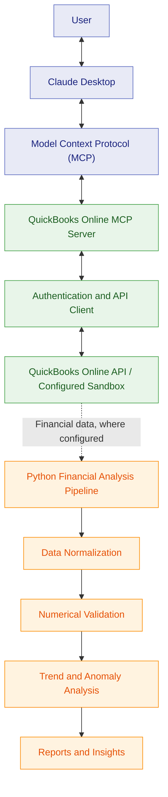

<div align="center">

# RE Financial AI Solutions Builder

### AI-Powered Financial Intelligence with MCP & QuickBooks Online

Connecting AI assistants with financial systems through intelligent tools, financial analysis, and automated validation.

<br>


<br>

[Project Report](Project_Report.pdf) · [Architecture](architecture.pdf) · [Getting Started](START_HERE.md)

</div>

---

## Overview

An AI-assisted financial analysis solution integrating **Claude Desktop, Model Context Protocol (MCP), a QuickBooks Online MCP server, and Python-based financial processing**.

The project demonstrates structured AI-to-tool communication, financial data retrieval, numerical validation, trend analysis, anomaly detection, and automated evaluation.

## Key Features

| Feature | Description |
|---|---|
| **Claude + MCP** | Connect Claude Desktop to supported financial tools through MCP |
| **MCP Server** | Expose QuickBooks capabilities through structured tool calls |
| **QuickBooks Integration** | Retrieve company information and Profit & Loss reports |
| **Sandbox Support** | Support development and testing against the configured sandbox environment, where implemented |
| **Financial Validation** | Check calculations and financial data consistency |
| **Trend Analysis** | Compare financial performance across reporting periods |
| **Anomaly Detection** | Identify unusual financial patterns |
| **AI-Assisted Analysis** | Support financial interpretation through configured LLM workflows |
| **Automated Testing** | Validate application logic and supported workflows |
| **Reporting** | Generate analysis outputs and evaluation evidence |

## Architecture



*The MCP integration and financial analysis pipeline are distinct components. The diagram illustrates the major components; the exact data flow depends on the configured workflow.*

## Technology Stack

<div align="center">

| Technology | Role |
|---|---|
|  | Financial analysis, validation, and reporting |
|  | MCP server implementation |
|  | Standardized communication between AI clients and tools |
|  | AI assistant interface |
|  | Financial system integration |
|  | Python testing |
|  | MCP server testing |
|  | Version control |

</div>

## Project Structure

```text
RE-Financial-AI-Solutions-Builder/
├── README.md
├── START_HERE.md
├── Project_Report.pdf
├── architecture.pdf
│
├── abc-trend-analysis/
│   ├── scripts/
│   ├── tests/
│   ├── evals/
│   ├── docs/
│   ├── results/
│   └── requirements.txt
│
├── quickbooks-online-mcp-server/
│   ├── src/
│   ├── tests/
│   ├── scripts/
│   └── package.json
│
└── scripts/
```

| Component | Responsibility |
|---|---|
| `abc-trend-analysis/` | Financial analysis, normalization, validation, and reporting |
| `tests/` | Automated tests |
| `evals/` | Evaluation cases and validation workflows |
| `docs/` | Technical documentation and screenshots |
| `results/` | Generated analysis and evaluation outputs |
| `quickbooks-online-mcp-server/` | QuickBooks MCP server integration |
| `quickbooks-online-mcp-server/src/` | MCP tools, handlers, API client, and server |
| `scripts/` | Project utilities and report generation |

## Testing & Verification

The recorded verification run reported **779 passing automated checks**.

| Test Suite | Reported Result |
|---|---:|
| Python tests | 131 passed |
| MCP server Jest tests | 639 passed |
| Financial schema tests | 9 passed |
| **Total** | **779 passed** |

These figures describe the recorded verification run, not 779 live API integration tests or a code-coverage percentage. Verify the counts against the latest test results before publishing.

## Documentation

| Resource | Description |
|---|---|
| [Project Report](Project_Report.pdf) | Implementation, methodology, and verification |
| [Architecture Document](architecture.pdf) | System architecture and component relationships |
| [Getting Started](START_HERE.md) | Project setup instructions |
| [Financial Analysis Documentation](abc-trend-analysis/README.md) | Analysis pipeline |
| [MCP Server Documentation](quickbooks-online-mcp-server/README.md) | QuickBooks MCP integration |
| [Screenshots](abc-trend-analysis/docs/screenshots/) | Demonstration evidence |
| [Evaluation Results](abc-trend-analysis/results/) | Analysis and evaluation artifacts |

## Getting Started

**Prerequisites:** Python, Node.js, npm, and the required credentials for live QuickBooks integration.

Clone the repository:

```bash
git clone https://github.com/Chandrashekhar-cloud/RE-Financial-AI-Solutions-Builder.git
cd RE-Financial-AI-Solutions-Builder
```

Follow [START_HERE.md](START_HERE.md) for the project-specific setup instructions.

Configure credentials locally and consult each component's documentation for dependencies and execution commands.

Live QuickBooks workflows require valid credentials and appropriate access. Sandbox usage depends on the project's configured environment.

## Security

- Never commit `.env` files, OAuth tokens, API secrets, or private keys.
- Do not publish confidential financial statements or customer information.
- Review screenshots, reports, and generated data files before publishing.
- Use appropriately scoped credentials when connecting to QuickBooks Online.
- Verify whether the configured QuickBooks environment is a sandbox or a production company before running operations.

**Note:** The MCP server supports a broader range of QuickBooks operations than the read-only Profit & Loss demonstration. Available operations depend on the implemented tools and configured permissions.

## Author

**Chandrashekhar H S**

Computer Science Engineering | AI & ML

[GitHub Profile](https://github.com/Chandrashekhar-cloud)

---

<div align="center">

**AI · MCP · Claude · QuickBooks · Financial Intelligence**

*Connecting AI with real-world financial workflows.*

</div>
