# RE Financial AI Solutions Builder

**Financial trend analysis with MCP and QuickBooks Online — working prototype**

Python does the math. Claude explains it. Every number in the commentary can be traced back to a structured JSON file.

[Project Report](Project_Report.pdf) · [Architecture](architecture.pdf) · [Getting Started](START_HERE.md)

## Overview

A working prototype that combines Claude Desktop, the Model Context Protocol (MCP), a QuickBooks Online MCP server, and a Python financial analysis pipeline.

It demonstrates QuickBooks Sandbox report retrieval, deterministic financial calculations, trend analysis, anomaly checks, and automated evaluation of both numerical outputs and AI-generated commentary.

## Quick Start (No Credentials Needed)

```bash
git clone https://github.com/Chandrashekhar-cloud/RE-Financial-AI-Solutions-Builder.git
cd RE-Financial-AI-Solutions-Builder
pip install -r abc-trend-analysis/requirements.txt
python scripts/run_pipeline.py --offline
```

This command runs six stages:

1. Read-only gate check.
2. Saved QuickBooks P&L schema check.
3. Calculation engine with baseline comparison.
4. Output integrity check.
5. Nine golden evaluation cases.
6. Commentary grounding checks.

The offline workflow uses the supplied workbook and saved sandbox data. It does not call Claude or QuickBooks live.

See [START_HERE.md](START_HERE.md) for the full command list.

## What Was Built and What Was Reused

| Component | Status |
|---|---|
| Python calculation engine, adapters, reporter and CLI | Built in this project |
| Claude Skill (`monthly-trend-analysis`) | Built in this project |
| Golden cases, baseline regression check, commentary rubric and claim validator | Built in this project |
| QuickBooks MCP server | Open-source Intuit server, configured with write, update and delete tools disabled. The server core is not my original work |
| Multi-client AWS architecture | Proposed design only; not deployed |

## Key Features

| Feature | Description |
|---|---|
| Claude + MCP | Connect Claude Desktop to QuickBooks through a local MCP server |
| QuickBooks Integration | Retrieve company information and a Profit & Loss report from a sandbox company |
| Deterministic Engine | Decimal arithmetic; trailing-twelve-month calculations only when 12 consecutive months exist; missing values surfaced as warnings |
| Financial Validation | Reconciliation checks across revenue, margins, expenses and income |
| Anomaly Detection | Flags unusual patterns using configurable thresholds |
| Grounded Commentary | Checks AI-generated commentary against structured analysis output |
| Evaluation | Golden cases, regression baseline and a separate rubric for AI explanations |

## Architecture

The project contains two related but distinct workflows.

- **Workflow A — QuickBooks MCP connection:** Demonstrates connectivity between Claude Desktop and QuickBooks Online Sandbox through the MCP server.
- **Workflow B — Financial trend analysis:** Processes a workbook or saved, normalized financial report through a deterministic Python pipeline.

The Python pipeline does not automatically receive data from the MCP server unless an export and import step is configured.

```mermaid
flowchart TB
    subgraph MCP["Workflow A — QuickBooks MCP Connection"]
        U["User"] <--> CD["Claude Desktop"]
        CD <--> PROTO["Model Context Protocol"]
        PROTO <--> QMS["QuickBooks Online MCP Server"]
        QMS <--> API["Authentication and API Client"]
        API <--> QB["QuickBooks Online Sandbox API"]
        QB --> EVID["Saved Connection and Report Evidence"]
    end

    subgraph PY["Workflow B — Financial Trend Analysis"]
        INPUT["Workbook or Saved/Normalized Financial Report"]
        INPUT --> NORM["Data Normalization"]
        NORM --> ENG["Deterministic Python Calculation Engine"]
        ENG --> VAL["Reconciliation and Validation"]
        VAL --> OUT["analysis.json and report.md"]
        OUT --> SKILL["Claude Skill / Grounded Commentary"]
        SKILL --> FINAL["Insights and Evaluation Results"]
    end
```



The diagram separates the demonstrated MCP connection from the Python analysis pipeline. The AWS multi-tenant architecture is a proposal, not a deployed service.

## Tested and Not Tested

| Claim | Status | Detail |
|---|---|---|
| Offline pipeline | Tested | Six stages run through `python scripts/run_pipeline.py --offline` |
| Golden evaluation | Tested | 9/9 cases; score of 110/110; no regression against the saved baseline |
| Commentary evaluation | Tested | 100/100 on a custom four-part rubric; not an independent audit |
| Financial reconciliation | Tested | 126/126 checks: seven metrics across 18 periods, plus selected cross-checks; not an audit |
| Python tests at original submission | Tested | 119 tests |
| Python tests after later updates | Tested | 131 tests |
| MCP server Jest tests | Tested | 639 tests across 35 suites, exercising the configured open-source server code |
| QuickBooks Sandbox connection | Demonstrated | Completed through Claude Desktop against the sandbox company. Evidence is in `abc-trend-analysis/docs/screenshots/` and `abc-trend-analysis/results/` |
| Read-only behavior | Partly tested | Write, update and delete tools are not registered. This is an application-level guard, not proof that the OAuth token itself is read-only |
| Live pipeline mode | Not part of verified run | Requires sandbox credentials; verified results are from offline execution |
| Second real company | Not tested | A different-company case exists only as a synthetic golden case |
| A 19th month of data | Not tested | TTM calculations require 12 consecutive months |
| AWS multi-client deployment | Not built | Proposed architecture only |

## Technology Stack

| Technology | Role |
|---|---|
| Python | Financial analysis, validation and reporting |
| TypeScript | MCP server implementation |
| Model Context Protocol | Standard communication between Claude and tools |
| Claude Desktop | AI interface for the MCP demonstration |
| QuickBooks Online Sandbox | Financial system integration environment |
| Pytest | Python testing |
| Jest | MCP server testing |

## Project Structure

```text
RE-Financial-AI-Solutions-Builder/
├── README.md
├── START_HERE.md
├── Project_Report.pdf
├── architecture.pdf
├── abc-trend-analysis/
│   ├── scripts/
│   ├── tests/
│   ├── evals/
│   ├── docs/
│   ├── results/
│   └── requirements.txt
├── quickbooks-online-mcp-server/
│   ├── src/
│   ├── tests/
│   ├── scripts/
│   └── package.json
└── scripts/
```

### Component Responsibilities

| Component | Responsibility |
|---|---|
| `abc-trend-analysis/` | Analysis, normalization, validation and reporting |
| `abc-trend-analysis/tests/` | Python tests |
| `abc-trend-analysis/evals/` | Golden-case and commentary evaluation |
| `abc-trend-analysis/docs/` | Documentation and screenshots |
| `abc-trend-analysis/results/` | Generated analysis and evaluation artifacts |
| `quickbooks-online-mcp-server/` | QuickBooks MCP server |
| `scripts/` | Pipeline launchers and utilities |

## Documentation

| Resource | Description |
|---|---|
| [Project Report](Project_Report.pdf) | Implementation, methodology and recorded verification |
| [Architecture Document](architecture.pdf) | Prototype architecture, security considerations and proposed scaling design |
| [Getting Started](START_HERE.md) | Setup instructions and command list |
| Financial Analysis Documentation | Analysis pipeline documentation |
| MCP Server Documentation | QuickBooks MCP server documentation |
| Screenshots | Demonstration evidence |
| Evaluation Results | Analysis and evaluation artifacts |

## Security and Scope

- Never commit `.env` files, OAuth tokens, API secrets or private keys.
- Do not publish confidential financial statements or customer information.
- Review screenshots, reports and generated data files before publishing.
- Use appropriately scoped credentials when connecting to QuickBooks Online.
- Confirm that the configured QuickBooks environment is Sandbox before running operations.
- Write, update and delete tools are disabled by configuration. This is an application-level control, not a guarantee of token-level read-only access.
- Defense in depth requires appropriate OAuth scope restrictions at Intuit and independent verification of every exposed tool.
- `abc-trend-analysis/scripts/tools/seed_qbo_sandbox.py` is an optional sandbox importer for the stretch goal. It is not part of the read-only demonstration path.
- AWS multi-tenant hosting and isolation are proposed, not deployed.

## Updates After Initial Submission

Follow-up work focused on LLM-assisted commentary and validation.

- **LLM Inference:** Ran the commentary workflow using a model accessed through OpenRouter.
- **Numerical Claim Validation:** Checked 14 selected numerical claims against the generated structured analysis.
- **Grounded Output Checks:** Used evaluation and validation workflows to assess numerical grounding and flag unsupported claims.
- **Python Test Count:** Increased from 119 at original submission to 131 after subsequent updates.
- **MCP Server Tests:** Remain at 639 tests across 35 suites.

The model was used for inference and commentary only. No model training was performed as part of this project.

The original submitted ZIP file and PDF documents remain separate submission artifacts.

## Author

**Chandrashekhar H S**

Computer Science Engineering | AI & ML

[GitHub Profile](https://github.com/Chandrashekhar-cloud)
