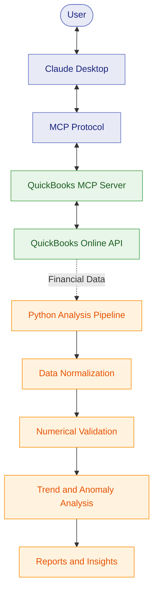

<div align="center">

# RE Financial AI Solutions Builder

**AI-Powered Financial Intelligence · MCP · QuickBooks Online**

Connecting AI assistants with financial systems for intelligent analysis, validation, and reporting.

<br>


[Project Report](Project_Report.pdf) · [Architecture](architecture.pdf) · [Getting Started](START_HERE.md)

</div>

---

## Overview

An AI-assisted financial analysis solution integrating **Model Context Protocol (MCP)**, **QuickBooks Online**, and Python-based financial processing.

The project demonstrates structured AI-to-tool communication, financial data retrieval, numerical validation, trend analysis, anomaly detection, and automated evaluation.

## Key Features

- **MCP Integration** — Connect Claude Desktop with supported QuickBooks tools.
- **Financial Data Retrieval** — Retrieve company information and Profit & Loss reports.
- **Numerical Validation** — Check financial calculations and data consistency.
- **Trend Analysis** — Compare financial performance across reporting periods.
- **Anomaly Detection** — Identify unusual financial patterns.
- **AI-Assisted Analysis** — Support financial interpretation through configured LLM workflows.
- **Automated Testing** — Validate application logic and supported workflows.
- **Reporting** — Generate analysis outputs and evaluation evidence.

## Architecture



*The MCP integration and financial analysis pipeline are distinct components. The diagram illustrates the conceptual workflow; actual data flow depends on the execution path.*

## Technology Stack

<div align="center">

| Technology | Purpose |
|:---:|---|
|  | Financial analysis, validation, and reporting |
|  | MCP server implementation |
|  | AI-to-tool communication |
|  | Financial system integration |
|  | AI assistant interface |
|  | Python testing |
|  | MCP server testing |
|  | Version control and collaboration |

</div>

## Project Structure

```text
RE-Financial-AI-Solutions-Builder/
├── README.md
├── START_HERE.md
├── Project_Report.pdf
├── architecture.pdf
├── abc-trend-analysis/
│   ├── scripts/
│   ├── tests/
│   ├── evals/
│   ├── docs/
│   ├── results/
│   └── requirements.txt
├── quickbooks-online-mcp-server/
│   ├── src/
│   ├── tests/
│   ├── scripts/
│   └── package.json
└── scripts/
```

| Component | Responsibility |
|---|---|
| `abc-trend-analysis/` | Financial analysis, normalization, validation, and reporting |
| `tests/` | Automated tests |
| `evals/` | Evaluation cases and validation workflows |
| `docs/` | Technical documentation and screenshots |
| `results/` | Generated analysis and evaluation outputs |
| `quickbooks-online-mcp-server/` | QuickBooks MCP server integration |
| `scripts/` | Project utilities and report generation |

## Testing & Verification

The recorded verification run reported **779 passing automated checks**.

| Test Suite | Reported Result |
|---|---:|
| Python tests | 131 passed |
| MCP server Jest tests | 639 passed |
| Financial schema tests | 9 passed |
| **Total** | **779 passed** |

These are results from the recorded verification run, not 779 live API integration tests or a code-coverage percentage. Verify these counts against the latest test results before publishing.

## Documentation

| Resource | Description |
|---|---|
| [Project Report](Project_Report.pdf) | Implementation, methodology, and verification |
| [Architecture](architecture.pdf) | System architecture and component relationships |
| [Getting Started](START_HERE.md) | Project setup instructions |
| [Financial Analysis Documentation](abc-trend-analysis/README.md) | Analysis pipeline |
| [MCP Server Documentation](quickbooks-online-mcp-server/README.md) | QuickBooks integration |
| [Screenshots](abc-trend-analysis/docs/screenshots/) | Demonstration evidence |
| [Evaluation Results](abc-trend-analysis/results/) | Analysis and evaluation artifacts |

## Getting Started

**Prerequisites:** Python, Node.js, npm, and appropriate credentials for live QuickBooks integration.

Clone the repository:

```bash
git clone https://github.com/Chandrashekhar-cloud/RE-Financial-AI-Solutions-Builder.git
cd RE-Financial-AI-Solutions-Builder
```

Follow [START_HERE.md](START_HERE.md) for setup and execution instructions.

Configure credentials locally and consult the documentation for each component's dependencies and commands. Live integration workflows require valid QuickBooks access.

## Security

- Never commit `.env` files, OAuth tokens, API secrets, or private keys.
- Do not publish confidential financial statements or customer information.
- Review screenshots, reports, and generated data files before publishing.
- Use appropriately scoped credentials when connecting to QuickBooks Online.

**Note:** The MCP server supports a broader range of QuickBooks operations than the read-only Profit & Loss demonstration. Available operations depend on the implemented tools and configured permissions.

## Author

**Chandrashekhar H S**

Computer Science Engineering | AI & ML

[GitHub Profile](https://github.com/Chandrashekhar-cloud)

---

<div align="center">

**AI · Financial Intelligence · MCP · Automation**

*Connecting AI with real-world financial workflows.*

</div>
