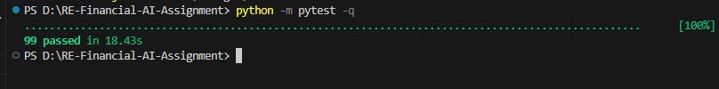
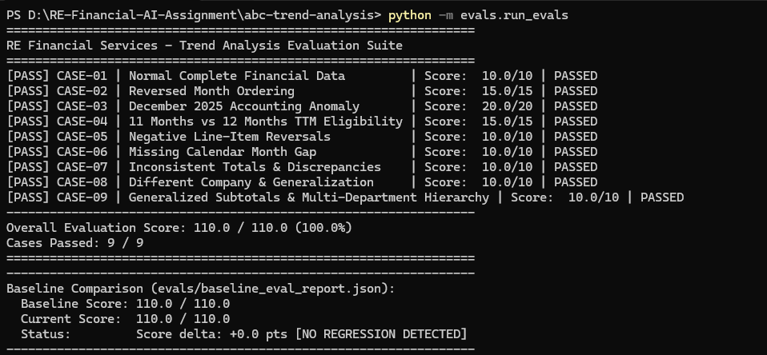
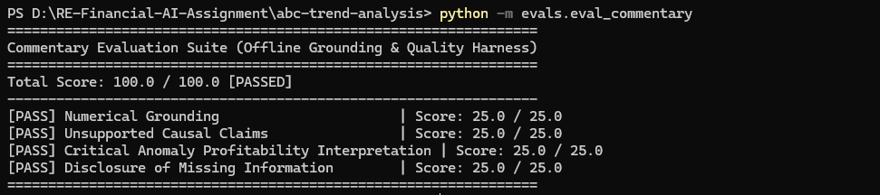

# Financial Trend Analysis Evaluation Suite & Regression Detection
**RE Financial Services — AI Solutions Builder Assignment (Task 3)**

---

## 1. Evaluation Philosophy & Approach

In financial and accounting AI systems, mathematical errors, missed anomalies, or hallucinated profitability are unacceptable failure modes.

The evaluation suite (`evals/run_evals.py`) establishes an automated, deterministic grading harness that tests the end-to-end trend analysis pipeline against **9 golden cases (110/110)** (exceeding the assignment requirement of 5 cases).

```
┌──────────────────────────────────────────────────────────────────────────────────┐
│                             EVALUATION PIPELINE FLOW                             │
├─────────────────────────┬────────────────────────────┬───────────────────────────┤
│ 1. Fixture Ingestion    │ 2. Deterministic Execution │ 3. Automated Assertion    │
│ • Synthetic Excel       │ • Run FinancialEngine      │ • Check output schema     │
│   edge fixtures         │ • Quantized Decimal sums   │ • Verify expected metrics │
│   in evals/fixtures/    │ • Anomaly detection flags  │ • Compute weighted score  │
└─────────────────────────┴─────────────┬──────────────┴───────────────────────────┘
                                        │
                                        ▼
┌──────────────────────────────────────────────────────────────────────────────────┐
│                      4. REGRESSION DETECTION & AUDIT LOG                         │
│ • Compare current run scores against saved baseline (evals/baseline_eval_report)│
│ • Flag any score drops, new assertion failures, or broken golden cases           │
│ • Emit machine-readable audit trail: results/eval_report.json                    │
└──────────────────────────────────────────────────────────────────────────────────┘
```

> **Fixtures vs. Real Workbook:** The 9 workbooks located in `evals/fixtures/` are strictly **synthetic edge test fixtures** engineered to stress specific failure modes (reverse chronological order, 11-month cutoffs, calendar month gaps, subtotal corruption, etc.). In contrast, the supplied production-style dataset (`data/ABC Inc - Financial Statements.xlsx`, covering 18 months from Jan 2025 to Jun 2026) is evaluated separately via comprehensive end-to-end regression testing in `tests/test_engine.py::TestRealWorkbookRegression`.

---

## 2. Golden Evaluation Cases & Weighted Scoring Rubric

Total score is **110.0 points** across 9 golden cases:

| Case ID | Case Name | Weight | Primary Assertions & Expected Output |
| :--- | :--- | :---: | :--- |
| **CASE-01** | Normal Complete Financial Data | 10 pts | 12 periods, forward order, 1 valid TTM, 0 reconciliation discrepancies, exact TTM revenue = $1,770,000.00. |
| **CASE-02** | Reversed Month Ordering | 15 pts | 12 periods, detects `months_were_reversed = True`, chronologically restores sequence from 2025-01 to 2025-12. |
| **CASE-03** | Dec 2025 Accounting Anomaly | 20 pts | Emits CRITICAL flag for $1.0M tax credit ($1,000,000.00 in the synthetic fixture; note the real ABC Inc workbook contains -$1,244,429.84), WARNING for SBC, and proves reported Op Income > $0 while Normalized Core Op Income < $0 (rejects false profitability). |
| **CASE-04** | 11 vs 12 Months TTM Eligibility | 15 pts | Withholds TTM calculations (0 valid windows) when dataset has only 11 months; emits informational TTM limitation flag. |
| **CASE-05** | Negative Line-Item Reversals | 10 pts | Flags revenue and expense reversals (e.g. credit memos in March 2026). |
| **CASE-06** | Missing Calendar Month Gap | 10 pts | Identifies calendar discontinuity (missing March 2025); invalidates TTM windows spanning across the missing gap. |
| **CASE-07** | Inconsistent Subtotals / Tampering | 10 pts | Injects corrupted expense row; verifies engine catches reconciliation discrepancy between line items and reported subtotal. |
| **CASE-08** | Multi-Company Generalization | 10 pts | Processes synthetic alternative chart of accounts (Test Corp test fixture in `evals/fixtures/case8_different_company.xlsx`) with zero code modifications; reconciles 100% of formulas. |
| **CASE-09** | Generalized Subtotals & Hierarchy | 10 pts | Processes financial statements with non-standard department subtotal hierarchies (Apex Dynamics fixture); avoids double-counting and reconciles 100% of formulas. |

---

## 3. Scoring Engine & Grading Formula

Each case is evaluated by `grade_case()` in `evals/run_evals.py`:
$$\text{Case Score} = \left( \frac{\text{Passed Assertions}}{\text{Total Assertions}} \right) \times \text{Case Weight}$$
$$\text{Total Suite Score} = \sum_{i=1}^{9} \text{Case Score}_i \quad (\text{Target: } 110.0 / 110.0)$$

If an assertion fails, the case is marked `FAILED` and points are deducted proportionately.

> **Scope of Evaluation Score:** The 110.0/110.0 score demonstrates that 100% of assertions passed across the 9 defined golden cases and synthetic edge fixtures. It confirms deterministic engine behavior on tested financial edge cases (reverse order, 11-month thresholds, month gaps, subtotal isolation, Dec 2025 tax credit anomalies, negative reversals), rather than asserting exhaustive coverage across all possible real-world accounting idiosyncrasies.

---

## 4. Regression Detection Strategy & Baseline Comparison

### The Regression Danger
A code modification in `engine.py` or calculation helpers might silently:
1. Re-introduce IEEE 754 floating-point drift.
2. Miss subtotal components and cause double-counting.
3. Accept false profitability in December 2025.
4. Calculate invalid TTM windows on incomplete datasets.

> **Evaluation Harness Scope & Skill Boundary:** The Python evaluation runner (`evals/run_evals.py`) strictly executes and grades the deterministic Python calculation engine (`scripts/engine.py`). It does **not** execute `SKILL.md` or invoke Claude. Claude's narrative layer is governed by `.claude/skills/monthly-trend-analysis/SKILL.md`. To independently evaluate commentary quality and guardrails, a dedicated commentary evaluator (`evals/eval_commentary.py`) verifies narrative text against `results/analysis.json` for numerical grounding, rejection of false profitability, and absence of unsupported causal claims.

### Automated Baseline Verification
1. **Golden Baseline Artifact:** The verified score of **110.0/110.0** is saved to `evals/baseline_eval_report.json`.
2. **Comparison Run:** Running `python -m evals.run_evals` automatically compares the current execution against `evals/baseline_eval_report.json`:
   - Verifies delta score ($\Delta \text{score} \ge 0.0$).
   - Flags any cases that transitioned from `PASSED` to `FAILED`.
   - Enforces a zero-regression policy in continuous integration (CI).
   - *(Note: Comparison is automated whenever the baseline file exists; no manual `--compare-baseline` CLI flag is required or supported).*
3. **CI/CD Integration Gate:** Any pull request modifying calculation logic must run `run_evals.py`. If the score drops below 100% or any golden case fails, the merge is blocked.

---

## 5. Commentary Evaluation Suite (`evals/eval_commentary.py`)

The `eval_commentary.py` module provides a deterministic, offline guardrail evaluation
framework for Claude's narrative commentary output. It does **not** invoke Claude or
any live LLM; it evaluates saved response text against `results/analysis.json`.

### Four Evaluation Dimensions

| Check | Weight | What It Verifies |
| :--- | :---: | :--- |
| **Numerical Grounding** | 25 pts | No monetary figure cited in commentary that cannot be traced to `analysis.json`. |
| **Unsupported Causal Claims** | 25 pts | Commentary does not assert external business causes (e.g. "customer churn", "pricing dispute") as fact when those causes are not recorded in the workbook. |
| **Critical Anomaly Profitability Interpretation** | 25 pts | Commentary does not describe the critical accounting anomaly period (e.g. Dec 2025) as genuinely operationally profitable. |
| **Disclosure of Missing Information** | 25 pts | Commentary includes required CPA review disclosures, credit memo audit flags, and unmapped account status. |

### Heuristic Limitations

This evaluator is rule-based, not an LLM judge. Known limitations:

- **Numerical grounding check** uses string matching against known values from `analysis.json`. A hallucinated number that coincidentally matches a rounding artefact of a known value could be missed.
- **Causal claim detection** uses keyword pattern matching. A sophisticated but unverified causal claim phrased differently from the keyword list could be missed.
- **Profitability rejection check** looks for specific denial phrases. Commentary that is silent about December 2025 altogether may pass this check without making the required disclosure.

For production use, this evaluator is a fast deterministic gate — not a substitute for human CPA review of Claude's commentary quality.

### Usage

```powershell
# Run the commentary evaluation harness directly:
python -m evals.eval_commentary

# Runs as part of the mutation test suite:
python -m pytest tests/test_eval_mutation.py -v

# Or standalone against any custom commentary text:
python -c "
from evals.eval_commentary import CommentaryEvaluator
import json
data = json.load(open('results/analysis.json'))
text = open('results/report.md').read()
result = CommentaryEvaluator(data).evaluate(text)
print('Passed:', result['passed'], '| Score:', result['total_score'])
"
```

---

## 6. Successful Evaluation & Test Evidence

### 1. Deterministic Unit, Integration & Regression Tests (Pytest)
Automated Pytest tests pass cleanly:



- **Suites:** `test_cli.py`, `test_engine.py` (Month ordering, Decimal arithmetic, subtotal non-duplication, MoM %, TTM eligibility, anomaly detection, generalization, unmapped accounts reporting, and real ABC Inc workbook regression), and `test_eval_mutation.py` (grader mutation tests and commentary evaluation guardrail tests).

### 2. Golden Case Evaluation Harness (`run_evals.py`)
The automated evaluation harness executes and verifies against all 9 golden cases:



- **Overall Score:** 110.0 / 110.0 (100.0%)
- **Cases Passed:** 9 / 9 (CASE-01 through CASE-09)
- **Baseline Delta:** +0.0 pts (Zero regression detected against `evals/baseline_eval_report.json`)

### 3. Commentary Evaluation Suite (`eval_commentary.py`)
The offline rule-based commentary evaluation harness executes and verifies all 4 categories:



- **Overall Score:** 100.0 / 100.0 (100.0%)
- **Categories Passed:** 4 / 4 (Numerical Grounding, Unsupported Causal Claims, Critical Anomaly Profitability Interpretation, Disclosure of Missing Information)

